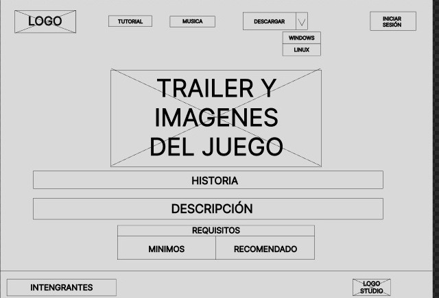
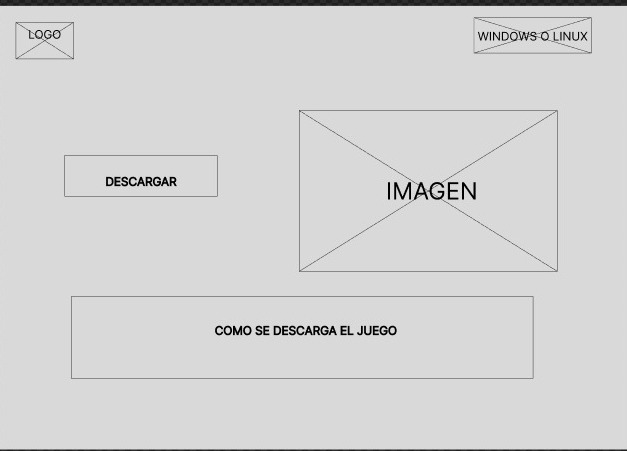

# RIFT OVERDRIVE — Sitio web (TP4: migración a PHP, SSI y SSR)

Sitio web escolar de **RIFT OVERDRIVE**, un videojuego FPS futurista con portales (proyecto ficticio de la Escuela Técnica).

En esta etapa (Unidad 4) el sitio estático HTML/CSS/JS se migró a **PHP**: las páginas ahora se generan en el servidor (SSR), las partes repetidas (encabezado, menú y pie) se reutilizan con **Server Side Includes** y la configuración global vive en un archivo **.env**.

## Resumen de la refactorización

- Las 10 páginas pasaron de `.html` a `.php`.
- Se extrajeron las partes repetidas a plantillas en `includes/`: `header.php`, `nav.php` y `footer.php`.
- El `<title>` de cada página es dinámico (variable `$titulo_pagina`).
- El menú marca con la clase `active` la página en la que estás.
- Los datos globales (nombre del sitio, correo de contacto, entorno) se leen desde un archivo `.env` que **no** se sube a Git; se incluye `.env.example` como plantilla.

## Prototipo en Figma

> 🔗 [Ver prototipo en Figma](https://www.figma.com/design/MDORQO1waMklJzQfQyknGl/WhatsApp-Image-2026-04-18-at-00.12.05?node-id=0-1&p=f&t=A0Uj3abd00BNpCVs-0)

Wireframes del diseño original:





## Tecnologías utilizadas

- HTML5 y CSS3
- JavaScript (menú desplegable, acordeón, lightbox, modo claro/oscuro, validación y resumen del formulario)
- PHP 8.x (`require_once`, variables, constantes)
- XAMPP (servidor local con Apache)
- Git y GitHub

## Estructura del proyecto

```
├── config/
│   └── env.php            # lee el .env y define las constantes (APP_NAME, APP_EMAIL, APP_ENV)
├── includes/
│   ├── header.php         # <head>, metadatos, CSS y <title> dinámico
│   ├── nav.php            # logo + menú de navegación (con clase "active")
│   └── footer.php         # pie de página + scripts de JavaScript
├── css/  js/  img/  capturas/
├── index.php  blog.php  galeria.php  contacto.php  descarga.php
├── login.php  preguntas.php  quienes-somos.php  terminos.php  CV.php
├── .env.example           # plantilla de variables de entorno
├── .gitignore             # excluye el .env real
├── robots.txt  sitemap.xml
└── README.md
```

## Cómo funciona

Cada página define sus variables y arma la vista con los includes:

```php
<?php
$titulo_pagina = 'Contacto — RIFT OVERDRIVE';
require_once 'includes/header.php';
require_once 'includes/nav.php';
?>
  <main> ... contenido de la página ... </main>
<?php require_once 'includes/footer.php'; ?>
```

- **Título dinámico:** `header.php` imprime `$titulo_pagina` dentro de `<title>`.
- **Ítem activo del menú:** `nav.php` compara la página actual (`basename($_SERVER['PHP_SELF'])`) con cada link y agrega `class="active"`.
- **Variables de entorno:** `config/env.php` lee el `.env` y define `APP_NAME`, `APP_EMAIL` y `APP_ENV`, que se usan en el pie de página y en los correos de contacto.

## Instrucciones de instalación y ejecución local

1. Instalá **XAMPP** (https://www.apachefriends.org).
2. Cloná el repositorio dentro de `C:\xampp\htdocs`:
   ```bash
   git clone https://github.com/alanchili140-dotcom/web-rift-overdrive.git
   ```
3. Copiá la plantilla de variables de entorno (en la raíz del proyecto):
   ```bash
   copy .env.example .env
   ```
   En Linux o macOS: `cp .env.example .env`
4. Abrí el **XAMPP Control Panel** y tocá **Start** en **Apache**.
5. Entrá en el navegador a: `http://localhost/web-rift-overdrive/index.php`

> Alternativa sin XAMPP, si tenés PHP instalado: `php -S localhost:8000` dentro de la carpeta del proyecto, y abrí `http://localhost:8000/index.php`.

## Evidencia de funcionamiento

### Servidor local ejecutándose

El sitio corriendo en el navegador bajo `http://localhost/web-rift-overdrive/index.php`:


### Estructura modular (SSI)

División en plantillas `header.php`, `nav.php` y `footer.php`:


### Navegación dinámica

El título de la pestaña cambia según la página y el link activo se resalta en el menú (ejemplo en `contacto.php`):


### Configuración de variables de entorno

Plantilla `.env.example` presente en el repositorio:


Archivo `config/env.php`, que lee el `.env` y define las constantes:


## Flujo de trabajo en Git

- Rama de trabajo: `feature/migracion-php-ssi`, integrada a `main` mediante Pull Request.
- Commits atómicos y descriptivos (por ejemplo: `feat: agrega plantillas header, nav y footer con titulo dinamico y link activo`).
- El archivo `.env` está en `.gitignore`; solo se versiona `.env.example`.

## Notas

- Este proyecto requiere un servidor con PHP. **GitHub Pages no ejecuta PHP**, por eso el sitio se prueba de forma local con XAMPP.
- Los archivos de `descargas/` y las fotos de integrantes no están incluidos en el repositorio.

## Autor

Alan David Chiliguay — Escuela Técnica, Programación Web.