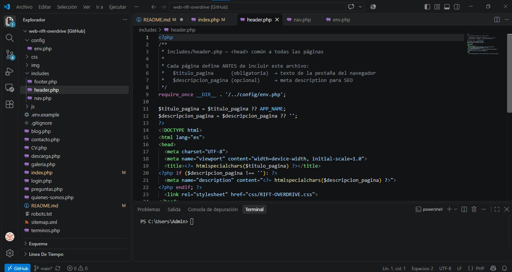
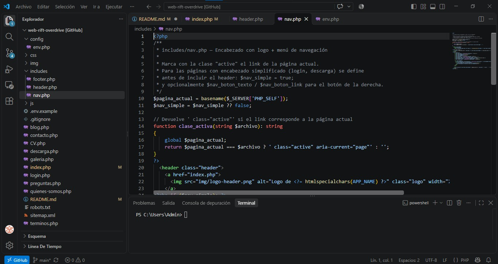
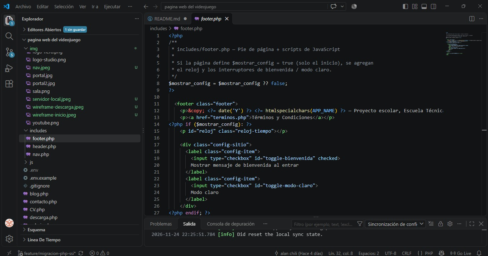
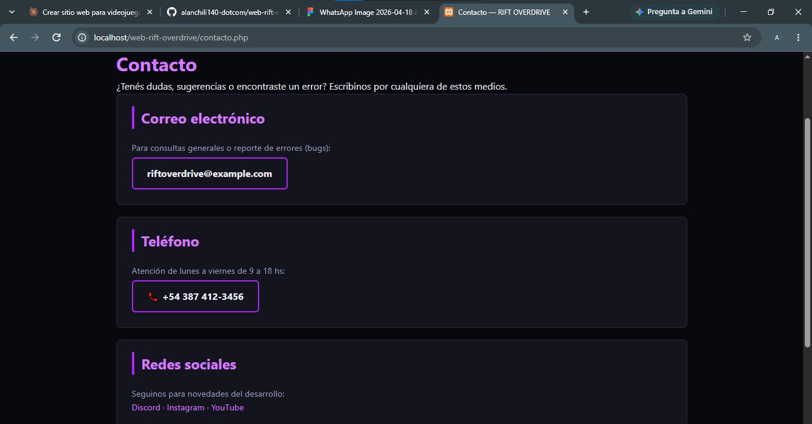
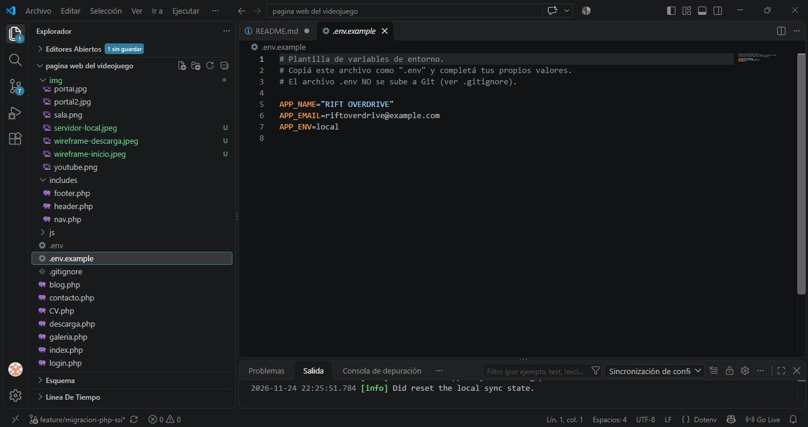
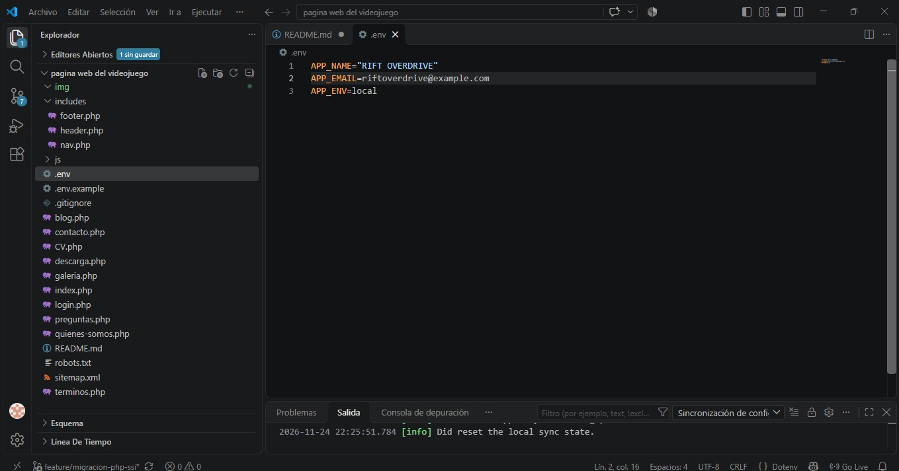
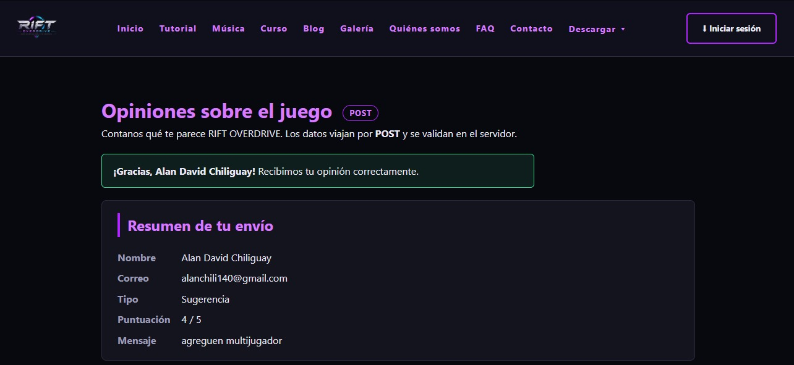
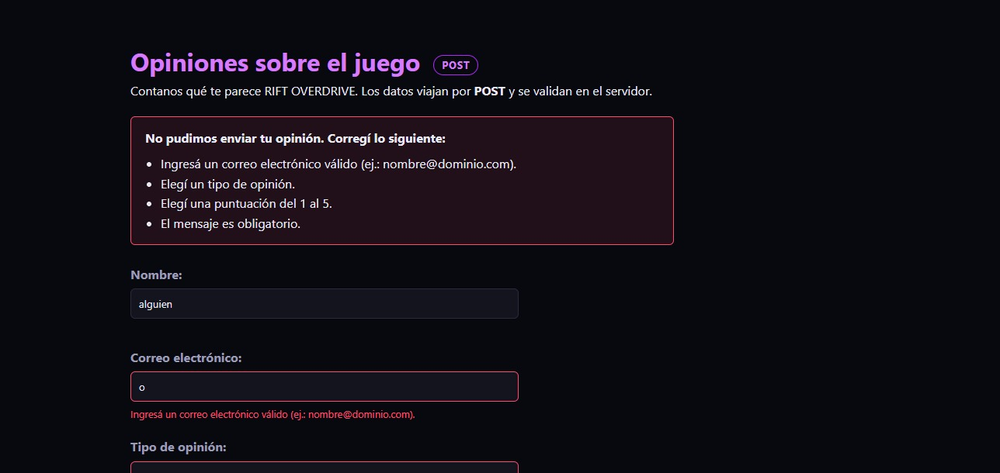
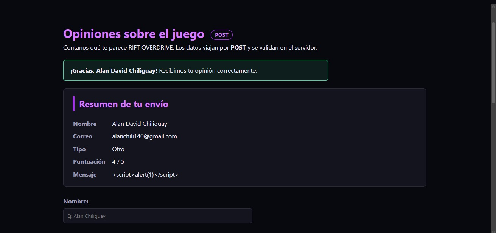
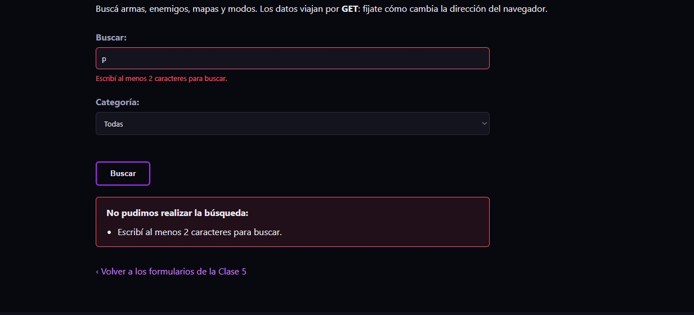

 
# RIFT OVERDRIVE — Sitio web (TP4: migración a PHP, SSI y SSR)
 
Sitio web escolar de **RIFT OVERDRIVE**, un videojuego FPS futurista con portales (proyecto ficticio de la Escuela Técnica).
 
En esta etapa (Unidad 4) el sitio estático HTML/CSS/JS se migró a **PHP**: las páginas ahora se generan en el servidor (SSR), las partes repetidas (encabezado, menú y pie) se reutilizan con **Server Side Includes** y la configuración global vive en un archivo **.env**.
 
## Resumen de la refactorización
 
- Las 10 páginas pasaron de `.html` a `.php`.
- Se extrajeron las partes repetidas a plantillas en `includes/`: `header.php`, `nav.php` y `footer.php`.
- El `<title>` de cada página es dinámico (variable `$titulo_pagina`).
- El menú marca con la clase `active` la página en la que estás.
- Los datos globales (nombre del sitio, correo de contacto, entorno) se leen desde un archivo `.env` que **no** se sube a Git; se incluye `.env.example` como plantilla.

## Prototipo en Figma

> 🔗 [Ver prototipo en Figma](https://www.figma.com/design/MDORQO1waMklJzQfQyknGl/WhatsApp-Image-2026-04-18-at-00.12.05?node-id=0-1&p=f&t=A0Uj3abd00BNpCVs-0).
 
Wireframes del diseño original:
 

 

 
## Tecnologías utilizadas
 
- HTML5 y CSS3
- JavaScript (menú desplegable, acordeón, lightbox, modo claro/oscuro, validación y resumen del formulario)
- PHP 8.x (`require_once`, variables, constantes)
- XAMPP (servidor local con Apache)
- Git y GitHub
## Estructura del proyecto
 
```
├── config/
│   └── env.php          # lee el .env y define las constantes (APP_NAME, APP_EMAIL, APP_ENV)
├── includes/
│   ├── header.php       # <head>metadatos, CSS y <title> dinámico
│   ├── nav.php          # logo + menú de navegación (con clase "active")
│   └── footer.php       # pie de página + scripts de JavaScript
├── css/  js/  img/  capturas/
├── index.php  blog.php  galeria.php  contacto.php  descarga.php
├── login.php  preguntas.php  quienes-somos.php  terminos.php  CV.php
├── .env.example           # plantilla de variables de entorno
├── .gitignore             # excluye el .env real
├── robots.txt  sitemap.xml
└── README.md
```
 
## Cómo funciona
 
Cada página define sus variables y arma la vista con los includes:
 
```php
<?php
$titulo_pagina = 'Contacto — RIFT OVERDRIVE';
require_once 'includes/header.php';
require_once 'includes/nav.php';
?>
  <main> ... contenido de la página ... </main>
<?php require_once 'includes/footer.php'; ?>
```
 
- **Título dinámico:** `header.php` imprime `$titulo_pagina` dentro de `<title>`.
- **Ítem activo del menú:** `nav.php` compara la página actual (`basename($_SERVER['PHP_SELF'])`) con cada link y agrega `class="active"`.
- **Variables de entorno:** `config/env.php` lee el `.env` y define `APP_NAME`, `APP_EMAIL` y `APP_ENV`, que se usan en el pie de página y en los correos de contacto.
## Instrucciones de instalación y ejecución local
 
1. Instalá **XAMPP** (https://www.apachefriends.org).
2. Cloná el repositorio dentro de `C:\xampp\htdocs`:
```bash
git clone https://github.com/alanchili140-dotcom/web-rift-overdrive.git
```
3. Copiá la plantilla de variables de entorno (en la raíz del proyecto):
```bash
copy .env.example .env
```
   En Linux o macOS: `cp .env.example .env`
4. Abrí el **XAMPP Control Panel** y tocá **Start** en **Apache**.
5. Entrá en el navegador a: `http://localhost/web-rift-overdrive/index.php`
 
> Alternativa sin XAMPP, si tenés PHP instalado: `php -S localhost:8000` dentro de la carpeta del proyecto, y abrí `http://localhost:8000/index.php`.
 
## Evidencia de funcionamiento
 
### Servidor local ejecutándose
 
El sitio corriendo en el navegador bajo `http://localhost/web-rift-overdrive/index.php`:
 

 
### Estructura modular (SSI)
 
División en plantillas `header.php`, `nav.php` y `footer.php`:
 

 

 

 
### Navegación dinámica
 
El título de la pestaña cambia según la página y el link activo se resalta en el menú (ejemplo en `contacto.php`):
 

 
### Configuración de variables de entorno
 
Plantilla `.env.example` presente en el repositorio:
 

 
Archivo `config/env.php`, que lee el `.env` y define las constantes:
 

 
## Flujo de trabajo en Git
 
- Rama de trabajo: `feature/migracion-php-ssi`, integrada a `main` mediante Pull Request.
- Commits atómicos y descriptivos (por ejemplo: `feat: agrega plantillas header, nav y footer con titulo dinamico y link activo`).
- El archivo `.env` está en `.gitignore`; solo se versiona `.env.example`.
## Notas
 
- Este proyecto requiere un servidor con PHP. **GitHub Pages no ejecuta PHP**, por eso el sitio se prueba de forma local con XAMPP.
- Los archivos de `descargas/` y las fotos de integrantes no están incluidos en el repositorio.
## Autor
 
Alan David Chiliguay — Escuela Técnica, Programación Web.


---

## Clase 5 — Procesamiento de formularios y seguridad web (POST y GET)

Todo el desarrollo de esta entrega está en la carpeta [`clase5/`](clase5/). Se agregaron dos formularios procesados en el servidor con PHP, con **validación**, **sanitización** contra **XSS** (OWASP Top 10) y **mensajes** al usuario.

### Archivos de la carpeta `clase5/`

| Archivo | Qué hace |
|---|---|
| `index.php` | Página de entrada con los dos formularios y un resumen de las medidas de seguridad |
| `opiniones.php` | Formulario por **POST** (opiniones sobre el juego) |
| `buscar.php` | Formulario por **GET** (buscador de armas, enemigos, mapas y modos) |
| `funciones.php` | Funciones de seguridad: `e()` (escape de salida), `limpiar_texto()`, `post()` y `get()` |

Las páginas reutilizan el `header.php`, `nav.php` y `footer.php` de `includes/`. Para poder usarlos desde una subcarpeta, los includes aceptan una variable `$ruta_base` (en `clase5/` vale `'../'`).

### Formulario POST — Opiniones (`clase5/opiniones.php`)

Campos: nombre, correo electrónico, tipo de opinión, puntuación (1 a 5), mensaje y aceptación.

- Se procesa solo si `$_SERVER['REQUEST_METHOD'] === 'POST'`.
- **Sanitización:** `filter_input()`, `trim()`, eliminación de caracteres de control y `FILTER_SANITIZE_EMAIL`.
- **Validación en servidor:** campos obligatorios, largo mínimo y máximo, nombre solo con letras, `FILTER_VALIDATE_EMAIL`, `FILTER_VALIDATE_INT` con rango 1–5 y lista blanca para el tipo.
- **Salida segura:** todo dato mostrado pasa por `htmlspecialchars()` (`ENT_QUOTES`, UTF-8).
- **Mensajes:** aviso de éxito con resumen de lo enviado, o lista de errores de validación con el detalle junto a cada campo.
- **Persistencia:** si hay errores, los campos conservan lo que el usuario había completado.

### Formulario GET — Buscador (`clase5/buscar.php`)

Campos: texto de búsqueda (`q`) y categoría (`categoria`). Ejemplo de URL: `buscar.php?q=plasma&categoria=armas`.

- Se procesa si llegan parámetros por `$_GET`.
- **Sanitización:** `filter_input()`, `trim()` y limpieza de caracteres de control.
- **Validación:** largo del texto (2 a 40 caracteres), categoría contra una lista blanca y al menos un criterio de búsqueda.
- **Salida segura:** el texto buscado y los resultados se imprimen con `htmlspecialchars()`.
- **Mensajes:** cantidad de resultados encontrados, aviso si no hay coincidencias o errores de validación.
- **Persistencia:** el texto y la categoría quedan cargados en el formulario.

### Capturas de pantalla

**1. Formulario POST funcionando (envío correcto con mensaje de éxito):**



**2. Formulario POST con errores de validación (datos conservados):**



**3. Intento de XSS en el formulario POST (el script se muestra como texto y no se ejecuta):**



**4. Buscador GET con resultados (se ve la URL con los parámetros):**


**5. Buscador GET con error de validación:**

