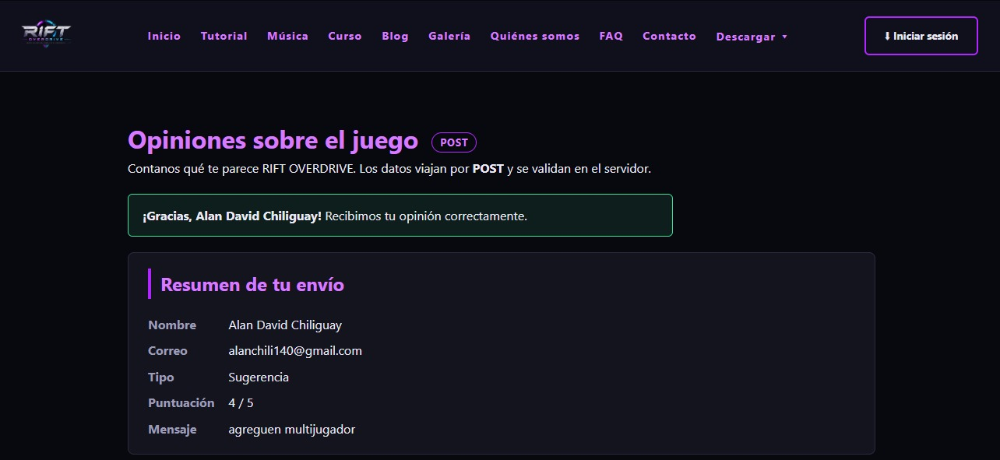
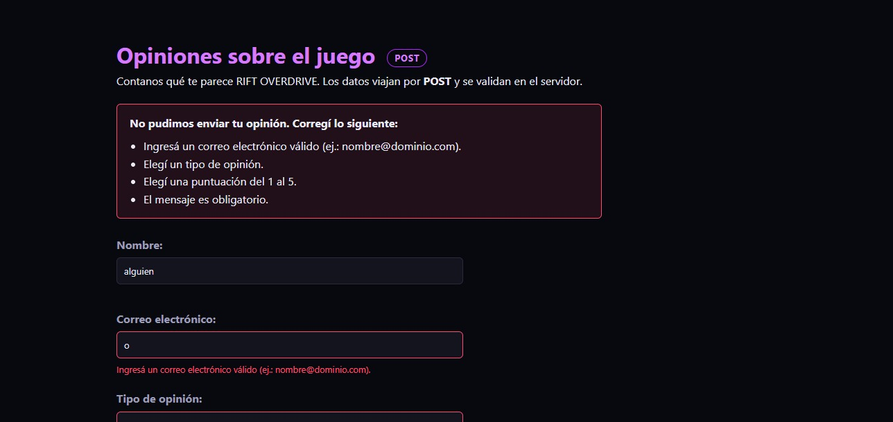
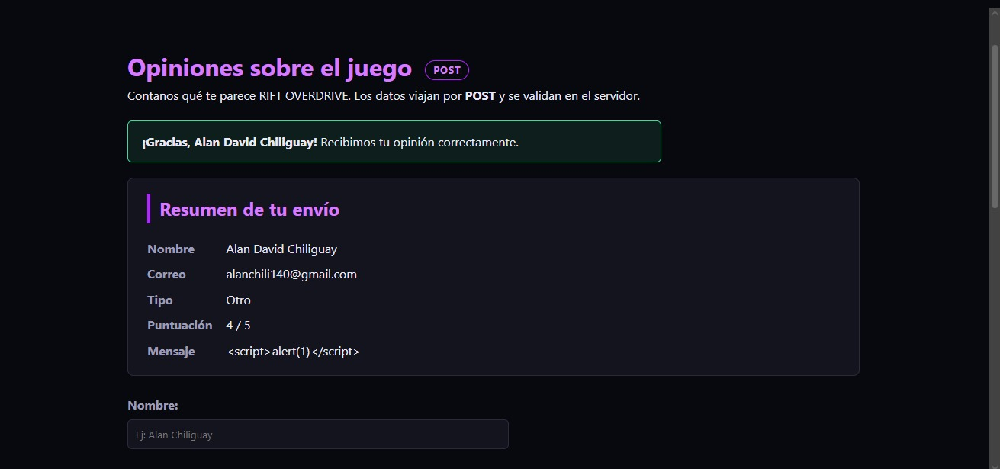
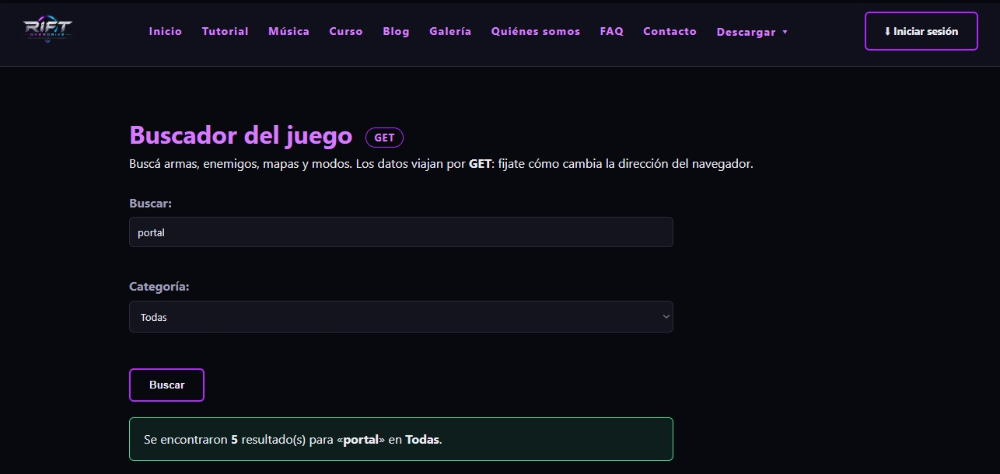
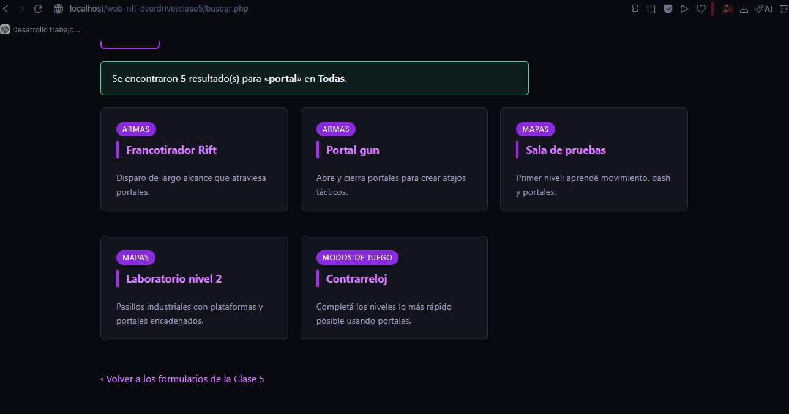
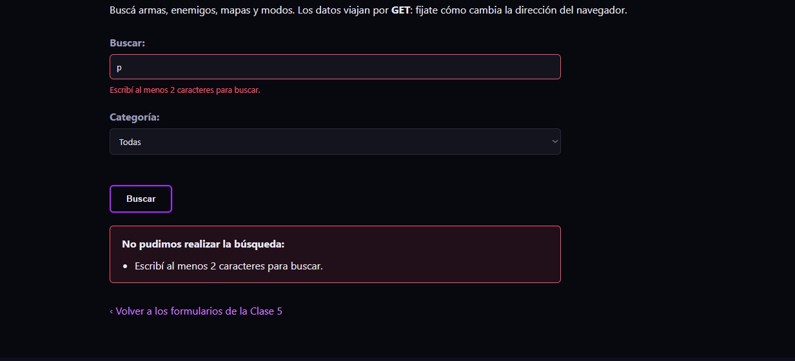

## Trabajo Practico 5 — Procesamiento de formularios y seguridad web (POST y GET)

Todo el desarrollo de esta entrega está en la carpeta [`tp5/`](./). Se agregaron dos formularios procesados en el servidor con PHP, con **validación**, **sanitización** contra **XSS** (OWASP Top 10) y **mensajes** al usuario.

### Archivos de la carpeta `tp5/`

| Archivo | Qué hace |
|---|---|
| `index.php` | Página de entrada con los dos formularios y un resumen de las medidas de seguridad |
| `opiniones.php` | Formulario por **POST** (opiniones sobre el juego) |
| `buscar.php` | Formulario por **GET** (buscador de armas, enemigos, mapas y modos) |
| `funciones.php` | Funciones de seguridad: `e()` (escape de salida), `limpiar_texto()`, `post()` y `get()` |

Las páginas reutilizan el `header.php`, `nav.php` y `footer.php` de `includes/`. Para poder usarlos desde una subcarpeta, los includes aceptan una variable `$ruta_base` (en `tp5/` vale `'../'`).

### Formulario POST — Opiniones (`tp5/opiniones.php`)

Campos: nombre, correo electrónico, tipo de opinión, puntuación (1 a 5), mensaje y aceptación.

- Se procesa solo si `$_SERVER['REQUEST_METHOD'] === 'POST'`.
- **Sanitización:** `filter_input()`, `trim()`, eliminación de caracteres de control y `FILTER_SANITIZE_EMAIL`.
- **Validación en servidor:** campos obligatorios, largo mínimo y máximo, nombre solo con letras, `FILTER_VALIDATE_EMAIL`, `FILTER_VALIDATE_INT` con rango 1–5 y lista blanca para el tipo.
- **Salida segura:** todo dato mostrado pasa por `htmlspecialchars()` (`ENT_QUOTES`, UTF-8).
- **Mensajes:** aviso de éxito con resumen de lo enviado, o lista de errores de validación con el detalle junto a cada campo.
- **Persistencia:** si hay errores, los campos conservan lo que el usuario había completado.

### Formulario GET — Buscador (`tp5/buscar.php`)

Campos: texto de búsqueda (`q`) y categoría (`categoria`). Ejemplo de URL: `buscar.php?q=plasma&categoria=armas`.

- Se procesa si llegan parámetros por `$_GET`.
- **Sanitización:** `filter_input()`, `trim()` y limpieza de caracteres de control.
- **Validación:** largo del texto (2 a 40 caracteres), categoría contra una lista blanca y al menos un criterio de búsqueda.
- **Salida segura:** el texto buscado y los resultados se imprimen con `htmlspecialchars()`.
- **Mensajes:** cantidad de resultados encontrados, aviso si no hay coincidencias o errores de validación.
- **Persistencia:** el texto y la categoría quedan cargados en el formulario.

### Capturas de pantalla

**1. Formulario POST funcionando (envío correcto con mensaje de éxito):**

**2. Formulario POST con errores de validación (datos conservados):**

**3. Intento de XSS en el formulario POST (el script se muestra como texto y no se ejecuta):**

**4. Buscador GET con resultados (se ve la URL con los parámetros):**

**5. Buscador GET con error de validación:**

