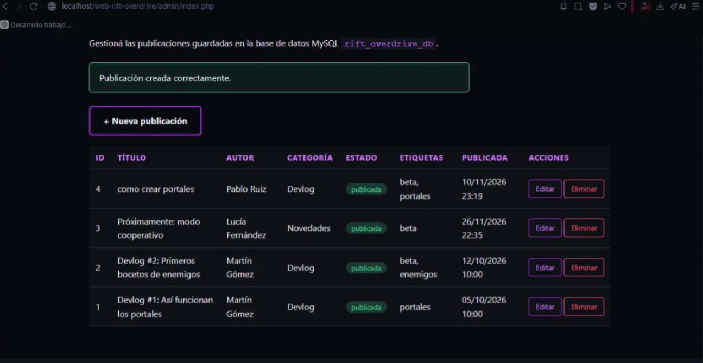
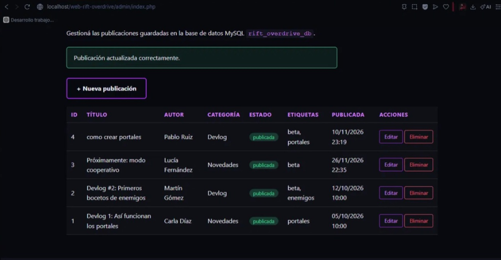
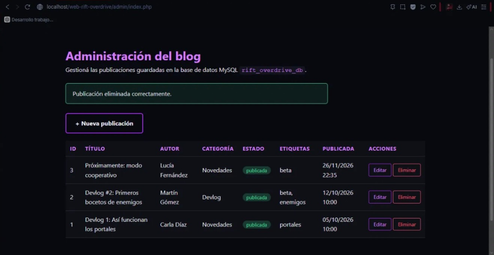
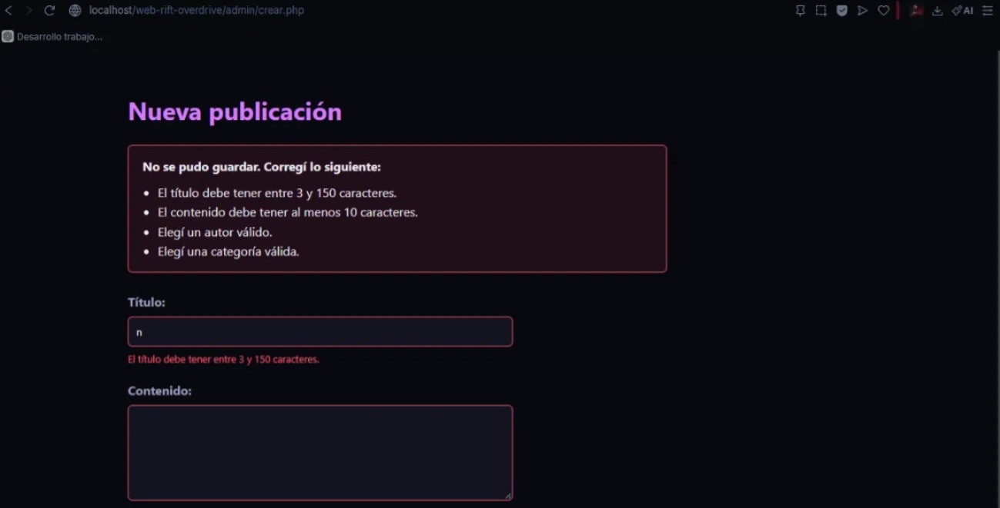
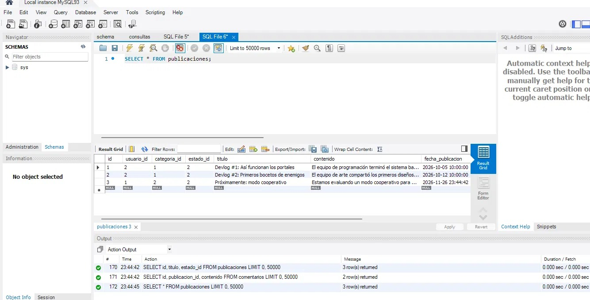

---

## TP7 – CRUD con PHP + MySQL (PDO)

Módulo de administración del **blog** de RIFT OVERDRIVE. Trabaja sobre la tabla `publicaciones` del modelo diseñado en el TP6 (`tp6/schema.sql`), con sus relaciones a `usuarios` (autor), `categorias`, `estados_publicacion` y `etiquetas` (relación N:M `publicacion_etiqueta`).

### Cómo probarlo en local (Apache de XAMPP + MySQL)

1. Iniciar **Apache** desde el panel de XAMPP (ejecuta PHP) y tener el servicio de **MySQL** encendido.
2. En MySQL Workbench ejecutar `tp6/schema.sql` y después `tp6/consultas.sql` (crea la base `rift_overdrive_db` con datos de prueba).
3. Copiar `.env.example` como `.env` y completar `DB_USER` y `DB_PASS` con los datos del MySQL local. El `.env` no se sube a Git.
4. Abrir `http://localhost/web-rift-overdrive/admin/index.php`.

### Archivos

| Archivo | Operación | Descripción |
|---|---|---|
| `config/conexion.php` | Conexión | Instancia PDO con `try-catch (PDOException)`, `ERRMODE_EXCEPTION` y `EMULATE_PREPARES = false`. Los datos salen del `.env`. |
| `admin/index.php` | **R**ead | Lista las publicaciones con `INNER JOIN` a autor, categoría y estado. |
| `admin/crear.php` | **C**reate | Formulario + `INSERT` preparado; la publicación y sus etiquetas se guardan en una transacción. |
| `admin/editar.php` | **U**pdate | Carga el registro con `SELECT` preparado y lo modifica con `UPDATE` preparado (también las etiquetas). |
| `admin/eliminar.php` | **D**elete | `DELETE` preparado; solo acepta `POST`. Las etiquetas y los comentarios asociados se borran por `ON DELETE CASCADE`. |
| `admin/helpers.php` | – | Función `e()` (htmlspecialchars), limpieza y validación compartida. |
| `admin/_form.php` | – | Formulario reutilizado por crear y editar. |

### Seguridad aplicada

- **Consultas preparadas** con marcadores `:nombre` en todos los `INSERT`, `UPDATE`, `DELETE` y en los `SELECT` que usan datos externos. Probado con un título como `'); DROP TABLE usuarios;--`: se guarda como texto y no ejecuta nada.
- **XSS**: toda variable impresa en HTML pasa por `htmlspecialchars()` (función `e()`).
- **Validación en el servidor**: longitudes, fecha válida y lista blanca para autor, categoría, estado y etiquetas (deben existir en la base).
- **Borrado por POST** con confirmación en el navegador, para que no se pueda eliminar con solo abrir un link.
- Los errores técnicos de la base se guardan en el log del servidor y el visitante ve un mensaje genérico.

### Capturas

**Listado de publicaciones (Read)**

**Alta de una publicación (Create)**

**Edición (Update)**

**Eliminación (Delete) y mensaje de confirmación**

**Validación en el servidor (formulario enviado con datos inválidos)**

**Datos guardados en MySQL (MySQL Workbench)**

