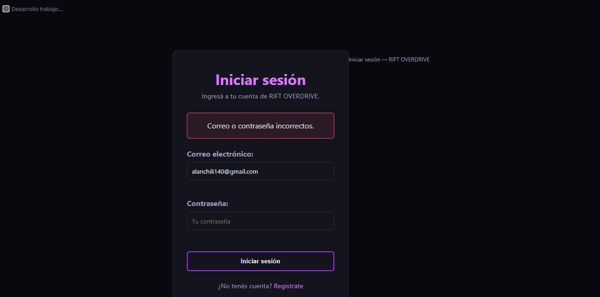
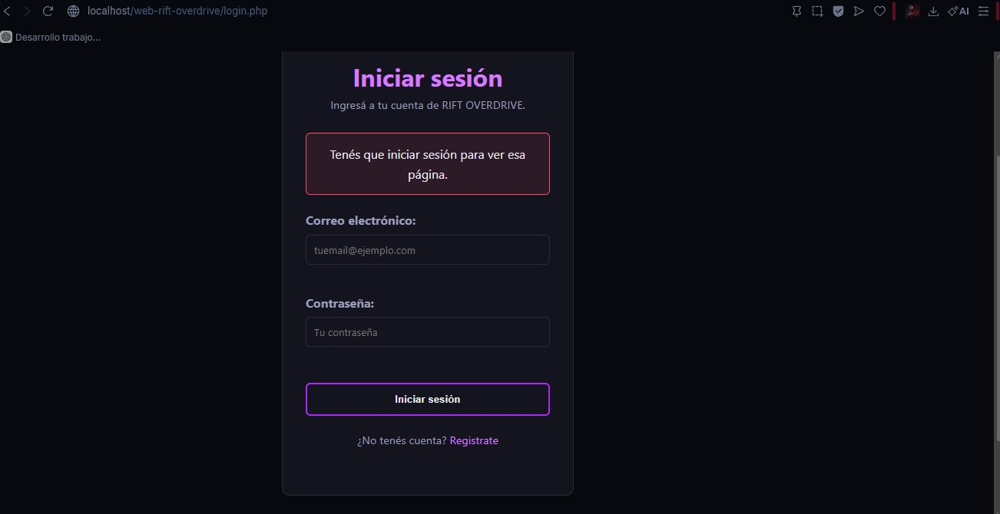
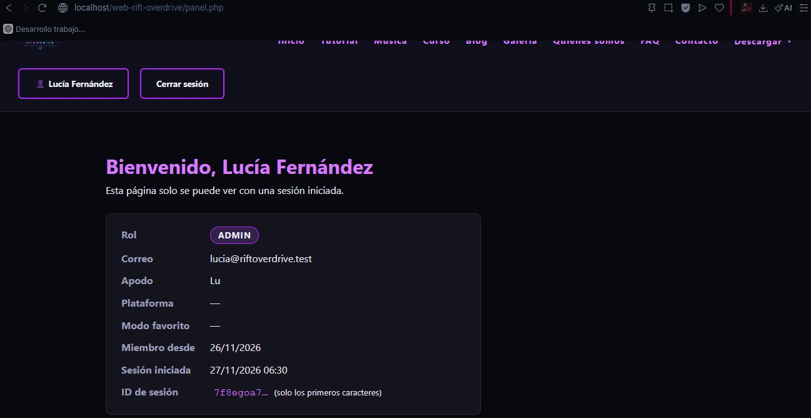
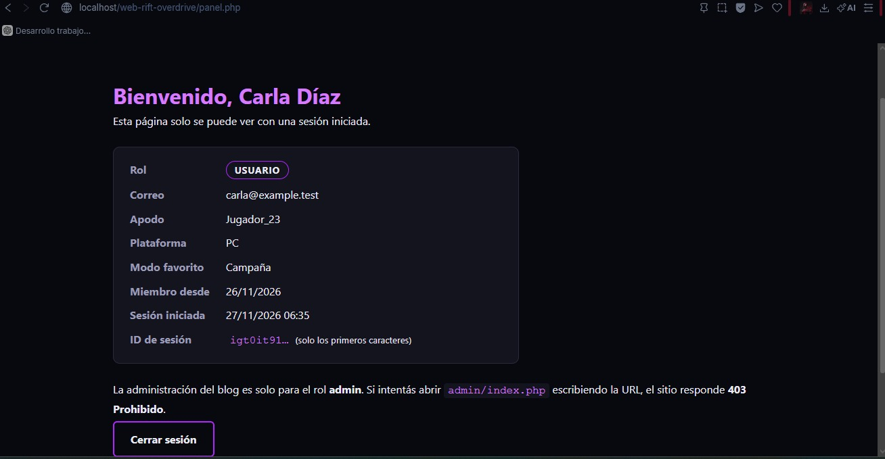
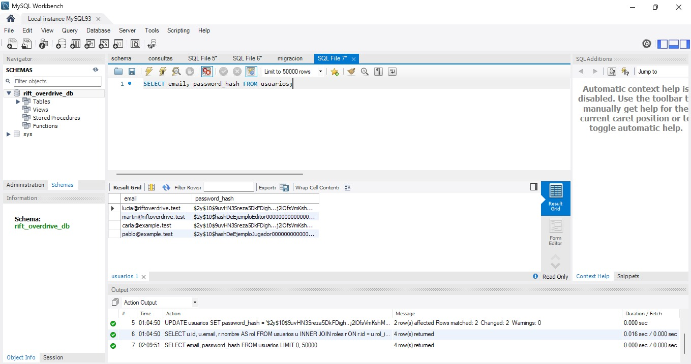

## TP8 – Sesiones, autenticación y control de acceso (PHP + MySQL)

Registro, inicio y cierre de sesión de usuarios de **RIFT OVERDRIVE**, con contraseñas hasheadas, sesiones PHP seguras y páginas protegidas por rol. Trabaja sobre la base `rift_overdrive_db` del TP6 y reutiliza la conexión PDO del TP7. Todo está integrado en la web principal (mismo encabezado, menú y estilos).

### Cómo probarlo en local (XAMPP)

1. Iniciar **Apache** y **MySQL** desde el panel de XAMPP.
2. Tener creada la base con `tp6/schema.sql` y `tp6/consultas.sql`.
3. Ejecutar **`tp8/migracion.sql`** (una sola vez): deja los roles como `admin` / `usuario` y les pone una contraseña real a dos cuentas de prueba.
4. Tener el `.env` con los datos de MySQL (ver `.env.example`).
5. Abrir `http://localhost/web-rift-overdrive/registro.php` o `login.php`.

**Cuentas de prueba (solo para la demo local)**

| Correo | Rol | Contraseña |
|---|---|---|
| `lucia@riftoverdrive.test` | admin | `Rift#2026Demo` |
| `carla@example.test` | usuario | `Rift#2026Demo` |

### Tabla `usuarios`

Se reutiliza la tabla del TP6, que ya está normalizada (3FN). Equivale a la estructura pedida en el enunciado:

| Pedido en el TP8 | Columna en `usuarios` | Detalle |
|---|---|---|
| `id` | `id` | `INT AUTO_INCREMENT PRIMARY KEY` |
| `nombre` | `nombre_completo` | `VARCHAR(80)` |
| `email` (único) | `email` | `VARCHAR(150)` con índice único `idx_usuarios_email` |
| `password` (255) | `password_hash` | `VARCHAR(255)`, guarda el hash bcrypt |
| `rol` (`admin` / `usuario`) | `rol_id` → `roles.nombre` | El rol está en la tabla `roles` (FK), no repetido como texto en cada usuario |
| `created_at` | `created_at` | `TIMESTAMP DEFAULT CURRENT_TIMESTAMP` |

### Archivos

| Archivo | Qué hace |
|---|---|
| `registro.php` | Formulario de alta. Sanitiza y valida en el servidor, verifica que el correo no exista y guarda la contraseña con `password_hash($password, PASSWORD_BCRYPT)` mediante `INSERT` preparado. |
| `login.php` | Busca al usuario con consulta preparada y compara con `password_verify()`. Si es correcto: `session_regenerate_id(true)`, guarda `usuario_id`, `usuario_nombre` y `rol` en `$_SESSION` y redirige a `panel.php`. |
| `logout.php` | Vacía `$_SESSION`, borra la cookie de sesión del navegador, ejecuta `session_destroy()` y redirige al login. |
| `includes/auth_guard.php` | Guardián reutilizable: si no hay `$_SESSION['usuario_id']` redirige a `login.php?error=acceso_denegado`. Incluye `verificarRol()` que responde **403** si el rol no corresponde. |
| `config/sesion.php` | `session_start()` seguro, token CSRF, logout completo y redirecciones. |
| `panel.php` | **Página protegida 1:** cualquier usuario autenticado. |
| `admin/*` (CRUD del TP7) | **Páginas protegidas 2:** solo rol `admin`. El guardián está en `admin/helpers.php`, que incluyen `index.php`, `crear.php`, `editar.php` y `eliminar.php`. |
| `includes/nav.php` | Muestra el nombre del usuario y "Cerrar sesión" cuando hay sesión iniciada. |
| `tp8/migracion.sql` | Ajusta los roles y deja cuentas de prueba. |

### Flujo de autenticación

```
registro.php ──(password_hash + INSERT preparado)──► usuarios
login.php ──(SELECT preparado + password_verify)──► session_regenerate_id(true)
         └─► $_SESSION[usuario_id, usuario_nombre, rol] ──► panel.php
página protegida ──► auth_guard.php ──► ¿hay sesión? ── no ──► login.php?error=acceso_denegado
                                    └─ sí ──► verificarRol('admin') ── no ──► 403 Prohibido
logout.php ──► $_SESSION vacío + cookie borrada + session_destroy() ──► login.php
```

### Seguridad aplicada (OWASP)

- **Hash de contraseñas:** `password_hash()` con `PASSWORD_BCRYPT` y `password_verify()`. Nunca texto plano, ni MD5/SHA1.
- **Session Fixation:** `session_regenerate_id(true)` apenas se validan las credenciales, y `session.use_strict_mode`.
- **Cookie de sesión:** `httponly` (JavaScript no la lee), `use_only_cookies` (el ID no viaja por la URL), `samesite=Lax`, y `secure` automático cuando el sitio se sirve por HTTPS (en `http://localhost` queda apagado para que funcione la demo).
- **Inyección SQL:** todas las consultas son preparadas (`:parametros`, PDO con `EMULATE_PREPARES = false`).
- **XSS:** toda variable impresa en HTML pasa por `htmlspecialchars()` (función `h()`), y las entradas se limpian en el servidor.
- **CSRF:** los formularios de login y registro llevan un token que se compara con `hash_equals()`.
- **Enumeración de usuarios:** el login responde con el mismo mensaje genérico ("Correo o contraseña incorrectos") y tarda lo mismo exista o no el correo.
- **Control de acceso:** autenticación (guardián) y autorización por rol (`verificarRol`), aplicados al inicio de cada página protegida. El rol `admin` no se puede elegir desde el formulario de registro.
- **Vencimiento por inactividad:** la sesión se invalida tras 30 minutos sin actividad.
- Los errores técnicos de la base se guardan en el log del servidor; al visitante se le muestra un mensaje genérico.

### Cómo se demuestra

1. Entrar a `panel.php` sin sesión → redirige a `login.php?error=acceso_denegado`.
2. Registrar una cuenta nueva (con un correo repetido y con datos inválidos para ver los errores).
3. Iniciar sesión con la cuenta nueva (rol `usuario`) → llega al panel. Abrir `admin/index.php` → **403 Prohibido**.
4. Cerrar sesión, iniciar con `lucia@riftoverdrive.test` (rol `admin`) → el panel muestra el acceso a la administración y el CRUD del TP7 funciona.
5. Cerrar sesión y volver a abrir `panel.php` → vuelve a pedir login.
6. En phpMyAdmin / Workbench: `SELECT email, password_hash FROM usuarios;` muestra los hashes (`$2y$10$...`), no las contraseñas.

### Capturas

**Registro con errores de validación**


**Login con credenciales incorrectas**



**Acceso denegado al abrir una página protegida sin sesión**



**Panel del usuario con la sesión iniciada**



**Un usuario sin rol admin intenta entrar a la administración (403)**



**Contraseñas guardadas como hash en MySQL**

